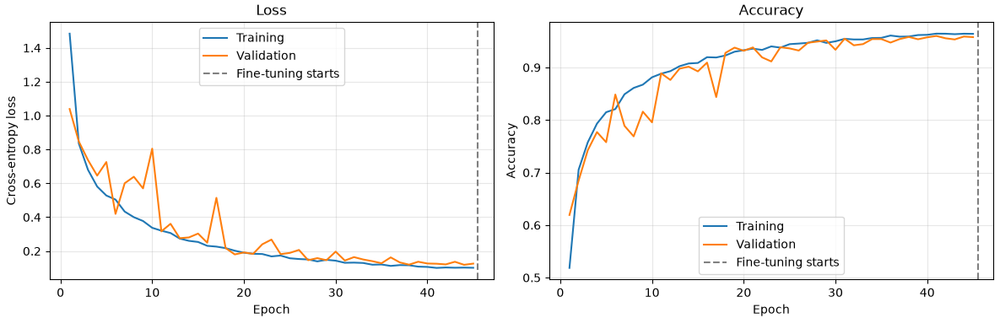

# EuroSAT Model

This is a simple CNN model designed to classify satellite images from the EuroSAT dataset. The dataset contains 10 classes with 27,000 images at a 64x64 resolution. The model reaches a accuarcy of around 95% on the test set.

## Motivation
The main purpose of making it was to practice new machine learning skills using pytorch.

## What is EuroSAT

EuroSAT is a widely used benchmark dataset designed for land use and land cover (LULC) classification using Earth observation satellite imagery. Sourced from the European Space Agency's Sentinel-2 satellite, it consists of 27,000 labeled image patches (sized 64x64 pixels) categorized across 10 distinct terrain classes, including forests, crops, rivers, highways, and residential areas.

## About the model
The model is a CNN model with 4 convolutional layers with kernel size of 3x3 and a fully connected layer with 2048x10.

| Stage | Layers | Output shape |
| --- | --- | --- |
| Input | RGB image | 3 × 64 × 64 |
| 1 | Conv 3×3 (16 channels), BatchNorm, ReLU, MaxPool 2×2 | 16 × 32 × 32 |
| 2 | Conv 3×3 (32 channels), BatchNorm, ReLU, MaxPool 2×2 | 32 × 15 × 15 |
| 3 | Conv 3×3 (64 channels), BatchNorm, ReLU, MaxPool 2×2 | 64 × 6 × 6 |
| 4 | Conv 3×3 (128 channels), BatchNorm, ReLU | 128 × 4 × 4 |
| Output | Flatten, Linear | 10 class scores |

## Choosing hyperparameters

Initially, I experimented with manually adjusting hyperparameters to observe how different values affected the model's performance. However, this approach proved inefficient for finding the optimal configuration. Therefore, I decided to use Optuna to automate the hyperparameter optimization process.

1. Epochs = 45
2. Learning rate = 0.01 - 0.000281472 (using StepLR)
3. Batch size = 128 images

## Training Process

Training time takes about 6-7 minuts on a RTX 3050 Ti laptop GPU with 4 GB VRAM and a i5-12500H CPU.

