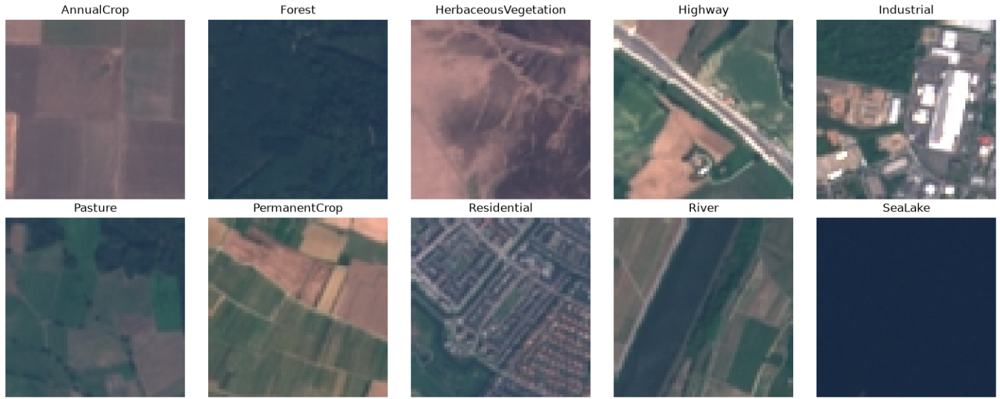
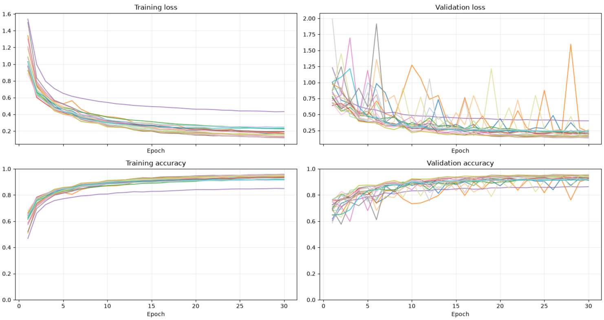
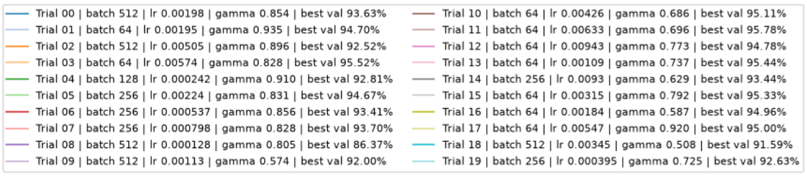
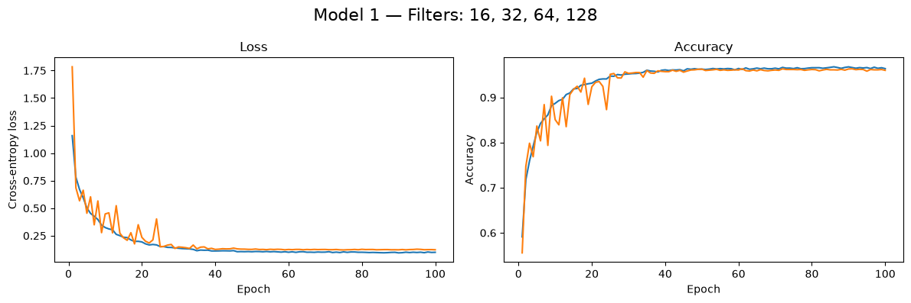
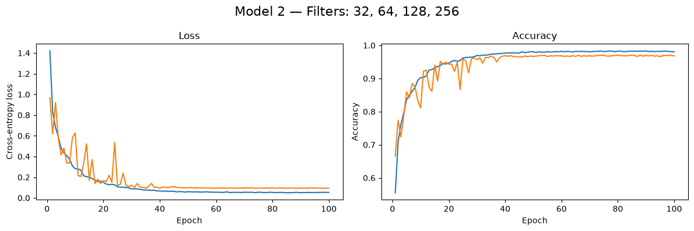
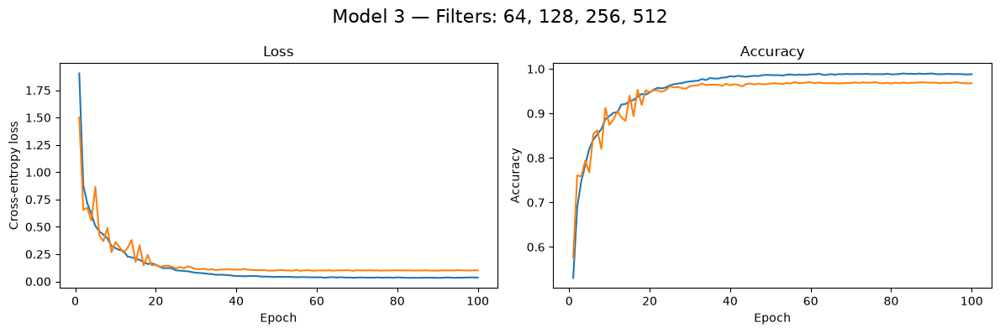

# EuroSAT Model

This is a simple CNN model designed to classify satellite images from the EuroSAT dataset. The dataset contains 10 classes with 27,000 images at a 64x64 resolution. The model reaches an accuracy of around 95% on the test set.

## Motivation
The primary goal of this project was to strengthen my PyTorch skills and gain practical experience applying core machine learning concepts.

In this project, I used:
1. PyTorch
2. Optuna
3. PyTorch Profiler
4. CNN Architecture
    1. Adam
    2. ReLU
    3. Learning rate decay — StepLR
    4. Batch Normalization
    5. Cross-entropy loss function
    6. Quantization
    7. Pruning

## What is EuroSAT?

EuroSAT is a widely used benchmark dataset designed for land use and land cover (LULC) classification using Earth observation satellite imagery. Sourced from the European Space Agency's Sentinel-2 satellite, it consists of 27,000 labeled image patches (sized 64x64 pixels) categorized across 10 distinct terrain classes, including forests, crops, rivers, highways, and residential areas.

## About the Model
The CNN architecture is summarized below.

| Stage | Layers | Output shape |
| --- | --- | --- |
| Input | RGB image | 3 × 64 × 64 |
| 1 | Conv 3×3 (16 channels), BatchNorm, ReLU, MaxPool 2×2 | 16 × 32 × 32 |
| 2 | Conv 3×3 (32 channels), BatchNorm, ReLU, MaxPool 2×2 | 32 × 15 × 15 |
| 3 | Conv 3×3 (64 channels), BatchNorm, ReLU, MaxPool 2×2 | 64 × 6 × 6 |
| 4 | Conv 3×3 (128 channels), BatchNorm, ReLU | 128 × 4 × 4 |
| Output | Flatten, Linear | 10 class scores |

## Choosing Hyperparameters

Initially, I experimented with manually adjusting hyperparameters to observe how different values affected the model's performance. However, this approach proved inefficient for finding the optimal configuration. Therefore, I decided to use Optuna to automate the process. After running Optuna across 20 trials to test different combinations of the learning rate, batch size, and StepLR gamma, here are the results:

From the results above, trial 11 performed the best.
|Initial learning rate|Batch size|StepLR gamma| Epochs| Best validation accuracy |
| --- | --- | --- | --- | --- |
| 0.00633 | 64 |  0.696  | 45 | 95.76 % |

After finding these hyperparameters, I continued trying to increase validation accuracy, but it did not exceed 96.33%. I then tried wider convolutions to see whether they would improve the result.

## Training Process

Training each model takes between 5 and 12 minutes using an RTX 3050 Ti laptop GPU with 4 GB VRAM and an i5-12500H CPU.

Below, I compare models that differ only in width. The wider models achieve higher validation accuracy in this run, but they also require more parameters and memory. The gap between the training and validation curves suggests some overfitting.

| Hyperparameter | Channels(16, 32, 64, 128)| Channels(32, 64, 128, 256) | Channels(64, 128, 256, 512)
| --- | ---: | ---: | ---:|
| Initial learning rate | 0.00633| 0.00633 | 0.00633 |
| Batch size | 64 | 64 | 64 |
| StepLR gamma | 0.696 | 0.696 | 0.696 |
| Epochs | 100 | 100 | 100
| Number of parameters |  118 170 | 429 866 | 1 633 866 |   
| Size | 0.474 MB | 1.723 MB | 6.543 MB |
| Best validation accuracy | 96.33% | 97.07% | 97.04% |

## Pruning

The [pruning notebook](notebooks/pruning.ipynb) uses structured filter pruning to reduce the size of all three CNNs. For each convolutional layer, it ranks filters by the L1 magnitude of their weights and keeps the highest-ranking filters. It also adjusts the following convolution, batch normalization, and final linear layer to match the remaining channels.

| Model | Original filters | Filters removed per layer | Parameters before | Parameters after | Size before | Size after |
| --- | --- | ---: | ---: | ---: | ---: | ---: |
| 1 | 16, 32, 64, 128 | approximately 35% | 118,170 | 55,074 | 0.4746 MB | 0.2216 MB |
| 2 | 32, 64, 128, 256 | approximately 54.3% | 429,866 | 99,700 | 1.7233 MB | 0.4006 MB |
| 3 | 64, 128, 256, 512 | approximately 77.15% | 1,633,866 | 99,700 | 6.5432 MB | 0.4006 MB |

Models 2 and 3 are pruned to similar sizes for comparison. Model 1 is smaller, while model 2 achieves higher validation accuracy before pruning and after fine-tuning in this run.

| Model | Before pruning | Immediately after pruning | After fine-tuning |
| --- | ---: | ---: | ---: |
| 1 | 96.33% | 16.11% | 91.30% |
| 2 | 97.07% | 16.30% | 92.48% |
| 3 | 97.04% | 14.63% | 89.30% |
