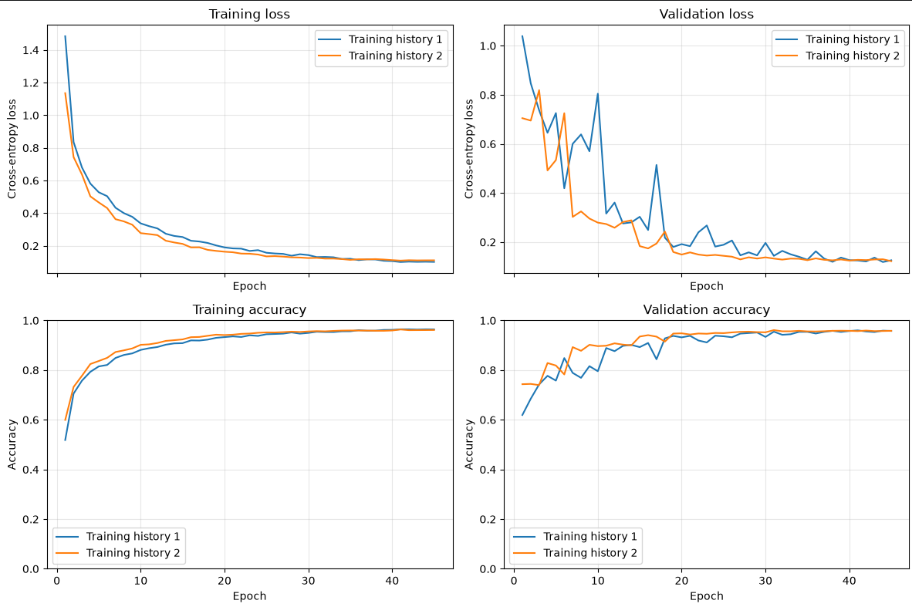

# EuroSAT Model

This is a simple CNN model designed to classify satellite images from the EuroSAT dataset. The dataset contains 10 classes with 27,000 images at a 64x64 resolution. The model reaches a accuarcy of around 95% on the test set.

## Motivation
The primary goal of this project was to strengthen my PyTorch skills and gain practical experience applying core machine learning concepts.

In this project i have used:
1. Learning Rate decay - stepLR
2. Batch Normalization
3. ReLU
4. optuna
5. Quantization
6. pruning
7. Pytorch
8. CNN
9. adam
10. Cross entorpy loss function
11. PyTorch Profiler

## What is EuroSAT

EuroSAT is a widely used benchmark dataset designed for land use and land cover (LULC) classification using Earth observation satellite imagery. Sourced from the European Space Agency's Sentinel-2 satellite, it consists of 27,000 labeled image patches (sized 64x64 pixels) categorized across 10 distinct terrain classes, including forests, crops, rivers, highways, and residential areas.

## About the Model
The CNN architecture is summarized below.

| Stage | Layers | Output shape |
| --- | --- | --- |
| Input | RGB image | 3 × 64 × 64 |
| 1 | Conv 3×3 (16 channels), BatchNorm, ReLU, MaxPool 2×2 | 16 × 32 × 32 |
| 2 | Conv 3×3 (32 channels), BatchNorm, ReLU, MaxPool 2×2 | 32 × 15 × 15 |
| 3 | Conv 3×3 (64 channels), BatchNorm, ReLU, MaxPool 2×2 | 64 × 6 × 6 |
| 4 | Conv 3×3 (128 channels), BatchNorm, ReLU | 128 × 4 × 4 |
| Output | Flatten, Linear | 10 class scores |

## Choosing Hyperparameters

Initially, I experimented with manually adjusting hyperparameters to observe how different values affected the model's performance. However, this approach proved inefficient for finding the optimal configuration. Therefore, I decided to use Optuna to automate the process. After running Optuna across 20 trials to test different combinations of the learning rate, batch size, and StepLR gamma, here are the results:

## Training Process

Training takes about 3–4 minutes on an RTX 3050 Ti laptop GPU with 4 GB VRAM and an i5-12500H CPU.

Below, I have compared the performance of the manually tuned hyperparameters against those found by Optuna. The Optuna settings (Training History 2) outperformed the manual settings (Training History 1) through most of the training process. By the end of training, the final accuracy is the same.

| Hyperparameter | Manually chosen (history 1) | Optuna trial 11 (history 2) |
| --- | ---: | ---: |
| Initial learning rate | 0.01 | 0.00633 |
| Batch size | 128 | 64 |
| StepLR gamma | 0.8 | 0.696 |
| Epochs | 45 | 45 |
| Best Validation Accuarcy | 96% | 96.11% |

## What to do next
find the bottleneck
lower the presision quantization
structured prune
